# Enterprise Entity-Relationship Diagram (ERD) Specification
**System:** Enterprise Resource & Operations Management System (EROMS)  
**Database Engine:** PostgreSQL 16.4 Relational Database Management System  
**Lead Architect:** [Muhammad Afnan](https://github.com/Afnan-makstrix)  

---

## 1. Relational Entity-Relationship Diagram (Mermaid)

```mermaid
erDiagram
    %% Core HR & Access Control
    DEPARTMENTS ||--o{ EMPLOYEES : "employs"
    ROLES ||--o{ PERMISSIONS : "has"
    EMPLOYEES ||--o{ USER_CREDENTIALS : "has login"
    EMPLOYEES ||--o{ EMPLOYEES : "manages (recursive)"
    EMPLOYEES ||--o{ ATTENDANCE : "logs daily"
    EMPLOYEES ||--o{ LEAVE_BALANCES : "tracks balances"
    EMPLOYEES ||--o{ LEAVE_REQUESTS : "requests"
    EMPLOYEES ||--o{ PAYROLL_RECORDS : "receives"
    
    %% Clients & Project Management
    CLIENTS ||--o{ PROJECTS : "commissions"
    PROJECTS ||--o{ PROJECT_MEMBERS : "assigns"
    EMPLOYEES ||--o{ PROJECT_MEMBERS : "works on"
    PROJECTS ||--o{ TASKS : "contains"
    TASKS ||--o{ TIME_ENTRIES : "logs hours"
    EMPLOYEES ||--o{ TIME_ENTRIES : "submits"
    
    %% Supply Chain & Inventory
    INVENTORY_CATEGORIES ||--o{ INVENTORY_ITEMS : "categorizes"
    INVENTORY_ITEMS ||--o{ WAREHOUSE_INVENTORY : "stocked in"
    WAREHOUSES ||--o{ WAREHOUSE_INVENTORY : "holds"
    INVENTORY_ITEMS ||--o{ INVENTORY_TRANSACTIONS : "tracked in ledger"
    WAREHOUSES ||--o{ INVENTORY_TRANSACTIONS : "recorded at"
    SUPPLIERS ||--o{ PURCHASE_ORDERS : "supplies"
    PURCHASE_ORDERS ||--o{ PURCHASE_ORDER_ITEMS : "details"
    INVENTORY_ITEMS ||--o{ PURCHASE_ORDER_ITEMS : "ordered"
    
    %% Financials, Sales & Billing
    CLIENTS ||--o{ SALES_INVOICES : "billed to"
    PROJECTS ||--o{ SALES_INVOICES : "originates from"
    SALES_INVOICES ||--o{ INVOICE_ITEMS : "line items"
    INVENTORY_ITEMS ||--o{ INVOICE_ITEMS : "sold"
    SALES_INVOICES ||--o{ PAYMENTS : "reconciled with"
    
    %% Audit & Notifications
    EMPLOYEES ||--o{ AUDIT_LOGS : "performed by"
    EMPLOYEES ||--o{ NOTIFICATIONS : "delivered to"

    DEPARTMENTS {
        bigint id PK
        varchar code UK
        varchar name
        numeric budget
        varchar location
        timestamp created_at
    }

    EMPLOYEES {
        bigint id PK
        varchar employee_number UK
        varchar first_name
        varchar last_name
        varchar email UK
        bigint department_id FK
        bigint role_id FK
        bigint manager_id FK
        numeric salary
        varchar status
        date hire_date
        timestamp deleted_at
    }

    ROLES {
        bigint id PK
        varchar name UK
        varchar description
    }

    USER_CREDENTIALS {
        bigint id PK
        bigint employee_id FK
        varchar username UK
        varchar hashed_password
        boolean is_active
        timestamp last_login
    }

    CLIENTS {
        bigint id PK
        varchar client_code UK
        varchar company_name
        varchar contact_email
        numeric credit_limit
    }

    PROJECTS {
        bigint id PK
        varchar project_code UK
        varchar name
        bigint client_id FK
        numeric budget
        varchar status
        date start_date
        date end_date
    }

    TASKS {
        bigint id PK
        bigint project_id FK
        bigint assigned_to_id FK
        varchar title
        varchar status
        varchar priority
    }

    INVENTORY_ITEMS {
        bigint id PK
        varchar sku UK
        varchar name
        bigint category_id FK
        numeric cost_price
        numeric selling_price
        integer reorder_level
    }

    WAREHOUSES {
        bigint id PK
        varchar code UK
        varchar name
        varchar location
    }

    WAREHOUSE_INVENTORY {
        bigint id PK
        bigint item_id FK
        bigint warehouse_id FK
        integer quantity_on_hand
    }

    SALES_INVOICES {
        bigint id PK
        varchar invoice_number UK
        bigint client_id FK
        bigint project_id FK
        numeric subtotal
        numeric tax_amount
        numeric total_amount
        numeric paid_amount
        numeric balance_due "STORED GENERATED"
        varchar payment_status
        date due_date
    }

    PAYMENTS {
        bigint id PK
        bigint invoice_id FK
        varchar payment_reference UK
        numeric amount
        timestamp payment_date
        varchar payment_method
        varchar status
    }

    AUDIT_LOGS {
        bigint id PK
        varchar table_name
        varchar action
        bigint record_id
        bigint user_id FK
        jsonb old_values
        jsonb new_values
        timestamp created_at
    }
```

---

## 2. Table Cardinalities & Relationship Architecture

| Primary Entity | Foreign / Child Entity | Cardinality | Enforced Constraints & Cascade Semantics |
| :--- | :--- | :---: | :--- |
| `departments` | `employees` | 1 : N | `ON DELETE RESTRICT` (Cannot drop department with active staff) |
| `employees` (manager) | `employees` (staff) | 1 : N | Self-referential FK `ON DELETE SET NULL` (Recursive hierarchy) |
| `roles` | `permissions` | 1 : N | `ON DELETE CASCADE` |
| `employees` | `user_credentials` | 1 : 1 | `UNIQUE(employee_id)`, `ON DELETE CASCADE` |
| `employees` | `attendance` | 1 : N | `UNIQUE(employee_id, work_date)`, composite B-tree index |
| `employees` | `leave_balances` | 1 : N | `UNIQUE(employee_id, leave_type_id, fiscal_year)` |
| `employees` | `leave_requests` | 1 : N | Check constraint: `end_date >= start_date` |
| `clients` | `projects` | 1 : N | `ON DELETE RESTRICT` |
| `projects` | `project_members` | 1 : N | Composite PK / Unique `(project_id, employee_id)` |
| `projects` | `tasks` | 1 : N | `ON DELETE CASCADE` |
| `inventory_items` | `warehouse_inventory` | 1 : N | `UNIQUE(item_id, warehouse_id)`, `quantity_on_hand >= 0` |
| `suppliers` | `purchase_orders` | 1 : N | `ON DELETE RESTRICT` |
| `purchase_orders` | `purchase_order_items`| 1 : N | `ON DELETE CASCADE`, composite uniqueness on `(po_id, item_id)` |
| `clients` | `sales_invoices` | 1 : N | `ON DELETE RESTRICT` |
| `sales_invoices` | `invoice_items` | 1 : N | `ON DELETE CASCADE`, stored generated column `line_total` |
| `sales_invoices` | `payments` | 1 : N | ACID trigger updating `paid_amount` & `payment_status` |
| `users` | `audit_logs` | 1 : N | Immutable append-only with native `jsonb` GIN indexing |

---

## 3. Database Normalization Decisions

1. **First Normal Form (1NF):**
   - Every column contains atomic values.
   - Elimination of repeating groups (e.g., invoice line items normalized into separate `invoice_items` child table).
   - Unique primary keys established across every single entity.

2. **Second Normal Form (2NF):**
   - All non-key attributes are fully functionally dependent on the primary key.
   - In junction tables (e.g., `project_members`, `role_permissions`, `warehouse_inventory`), non-key attributes depend on the complete composite key rather than a partial subset.

3. **Third Normal Form (3NF):**
   - Zero transitive dependencies.
   - Non-key attributes depend solely on the primary key, `the whole key, and nothing but the key`.
   - Employee department names are not stored in `employees`, but resolved through relational joins on `department_id`.
   - Inventory item names are never duplicated in `inventory_transactions` or `warehouse_inventory`.

4. **Strategic Denormalization (Generated Columns & Materialized Views):**
   - `sales_invoices.balance_due` is implemented as `GENERATED ALWAYS AS (total_amount - paid_amount) STORED`. This guarantees 100% mathematical consistency without application-layer divergence while retaining zero read overhead.
   - `mv_monthly_financial_summary` pre-aggregates gross sales, accounts payable receipts, and payroll into a refreshable materialized view indexed by `transaction_month`.
