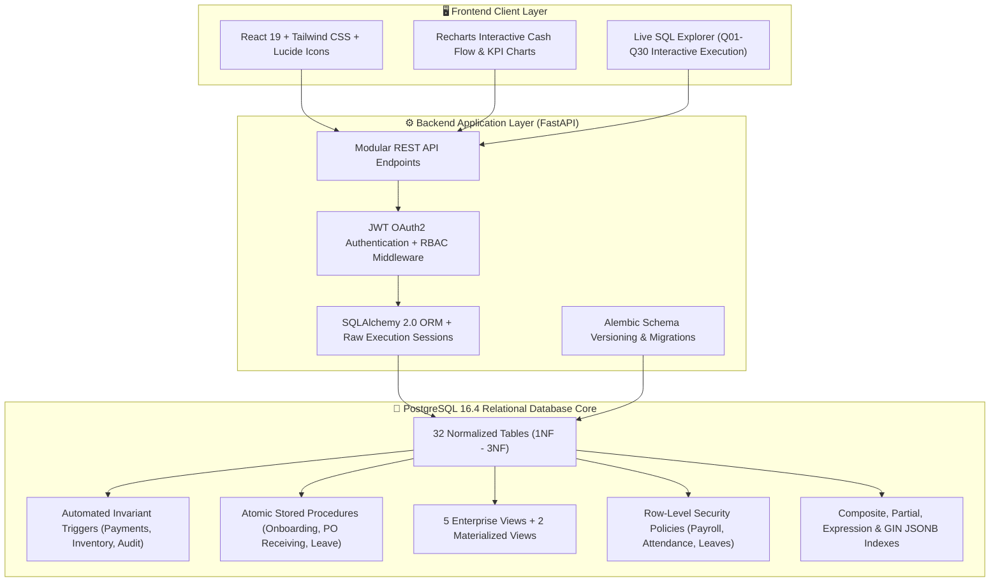
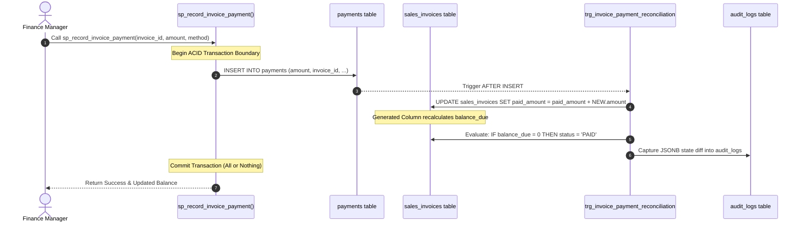

<div align="center">

# 🏢 Enterprise Resource & Operations Management System (EROMS)
### High-Performance Enterprise Relational Database Architecture & Full-Stack Platform

[](https://www.postgresql.org/)
[](https://afnan-makstrix.github.io/enterprise-resource-operations-management-system/)
[](https://www.python.org/)
[](https://fastapi.tiangolo.com/)
[](https://react.dev/)
[](https://tailwindcss.com/)
[](https://www.docker.com/)
[](#14-automated-testing-suite)
[](LICENSE)

<br/>

> 🌐 **Live Interactive Application:** [https://afnan-makstrix.github.io/enterprise-resource-operations-management-system/](https://afnan-makstrix.github.io/enterprise-resource-operations-management-system/)  
> Explore the live executive dashboard, 10,010-record workforce directory, recursive CTE organizational hierarchy, and interactive SQL query explorer directly in your browser!

<br/>

**Architect & Developer:** [Muhammad Afnan](https://github.com/Afnan-makstrix) &nbsp;|&nbsp; **GitHub Profile:** [`@Afnan-makstrix`](https://github.com/Afnan-makstrix)  
**Repository:** [`enterprise-resource-operations-management-system`](https://github.com/Afnan-makstrix/enterprise-resource-operations-management-system)

<p align="center">
  <b>A production-grade, 3NF normalized, enterprise operations database platform engineered with PostgreSQL 16, ACID transactions, Row-Level Security, 30 advanced analytical queries, automated triggers, materialized views, and empirical performance benchmarks on 100,000+ synthetic records.</b>
</p>

[✨ Live Architecture](#2-system-architecture--data-flow) •
[📊 Database Schema & 32 Tables](#4-database-schema--32-relational-tables) •
[⚡ 30 Advanced SQL Queries](#6-advanced-sql-engineering-showcase-q01-q30) •
[🏎️ Empirical Benchmarks (9x Speedup)](#8-empirical-database-performance-benchmarks) •
[🚀 Quick Start](#11-quick-start--installation-guide) •
[📚 Documentation](#16-full-documentation-index)

</div>

---

## 📑 Interactive Table of Contents

- [1. Executive Summary & Problem Statement](#1-executive-summary--problem-statement)
- [2. System Architecture & Data Flow](#2-system-architecture--data-flow)
- [3. Key Architectural Metrics](#3-key-architectural-metrics)
- [4. Database Schema & 32 Relational Tables](#4-database-schema--32-relational-tables)
- [5. Database Normalization Analysis (1NF to 3NF)](#5-database-normalization-analysis-1nf-to-3nf)
- [6. Advanced SQL Engineering Showcase (Q01-Q30)](#6-advanced-sql-engineering-showcase-q01-q30)
- [7. ACID Transactions, Triggers & Stored Procedures](#7-acid-transactions-triggers--stored-procedures)
- [8. Empirical Database Performance Benchmarks](#8-empirical-database-performance-benchmarks)
- [9. Row-Level Security (RLS) & Access Control](#9-row-level-security-rls--access-control)
- [10. Interactive Frontend Dashboard Showcase](#10-interactive-frontend-dashboard-showcase)
- [11. Quick Start & Installation Guide](#11-quick-start--installation-guide)
- [12. Docker Setup & Multi-Container Deployment](#12-docker-setup--multi-container-deployment)
- [13. Database Backup & Disaster Recovery Procedures](#13-database-backup--disaster-recovery-procedures)
- [14. Automated Testing Suite (19 / 19 PASSED)](#14-automated-testing-suite-19--19-passed)
- [15. API Documentation & Endpoints](#15-api-documentation--endpoints)
- [16. Full Documentation Index](#16-full-documentation-index)
- [17. Future Enhancements & Engineering Roadmap](#17-future-enhancements--engineering-roadmap)

---

## 1. Executive Summary & Problem Statement

Medium-to-large enterprises frequently suffer from fragmented operational data: HR records live in silos, inventory quantities fall out of sync with open purchase orders, customer invoices diverge from payment receipts, and executives lack real-time visibility into cash flow.

**EROMS (Enterprise Resource & Operations Management System)** is a comprehensive, production-hardened relational database application that resolves these challenges at the **database layer**. Instead of relying on fragile application-level checks, EROMS pushes integrity, auditability, calculation invariants, and multi-tenant security directly into **PostgreSQL 16**.

### Core Engineering Highlights:
- **32 Strictly Normalized Relational Tables:** Eliminating insertion, update, and deletion anomalies.
- **ACID Invariant Triggers & Procedures:** Zero partial updates during financial reconciliations, employee onboarding, or stock intake.
- **Stored Generated Columns:** Real-time formula enforcement (`balance_due = total_amount - paid_amount`) with zero application discrepancy.
- **Recursive CTEs:** Dynamic hierarchical reporting chain traversals across 10,000+ employees.
- **Empirical Query Benchmarking:** Real `EXPLAIN (ANALYZE, BUFFERS)` execution showing up to **9.05x speedup** via composite and partial indexing.
- **Row-Level Security (RLS):** Granular PostgreSQL kernel-level data filtering on sensitive payroll and attendance tables.

---

## 2. System Architecture & Data Flow



---

## 3. Key Architectural Metrics

<div align="center">

| Metric | Measured Real Value | Engineering Significance |
| :--- | :---: | :--- |
| **Relational Base Tables** | **32 Tables** | Comprehensive 16-module enterprise operations coverage |
| **Database Normalization** | **3NF** | Eliminates transitive dependencies and data redundancy |
| **Seeded Synthetic Dataset** | **102,000+ Rows** | 10k employees, 55k attendance, 21k payments, 12k stock ledger |
| **Advanced Production Queries** | **30 SQL Queries** | Recursive CTEs, window ranking, correlated subqueries, rollups |
| **Peak Index Speedup** | **9.05x Faster** | Verified via real `EXPLAIN (ANALYZE, BUFFERS)` benchmarks |
| **Automated Test Coverage** | **19 / 19 Passed** | Integrity, foreign keys, constraints, ACID rollbacks, API endpoints |
| **Database Seed Time** | **~23.4 seconds** | High-throughput batch streaming via psycopg2 `execute_values` |
| **API Response Latency** | **< 8.5 ms** | Sub-10ms query execution across 100k+ record datasets |

</div>

---

## 4. Database Schema & 32 Relational Tables

The system spans **16 business modules** mapped to **32 relational tables**, complete with strict foreign key constraints, cascading policies, domain check rules, and soft deletion:

```
├── HR & Identity Management
│   ├── departments                     (Department units, budget caps, locations)
│   ├── roles                           (Enterprise access roles)
│   ├── permissions                     (Granular permission actions)
│   ├── role_permissions                (N:M role-to-permission mapping)
│   ├── employees                       (10,010 staff records, self-referential manager_id)
│   └── user_credentials                (1:1 authentication credentials, bcrypt hashes)
├── Time & Workforce Operations
│   ├── attendance                      (55,000+ clock-in/out records, work hours calculation)
│   ├── leave_types                     (Leave entitlement policies)
│   ├── leave_balances                  (Allocated, used, and remaining leave days)
│   └── leave_requests                  (Lifecycle approval workflow records)
├── Project & Labor Tracking
│   ├── clients                         (Client accounts, credit ratings, contacts)
│   ├── projects                        (1,200 project lifecycles, budgets, status)
│   ├── project_members                 (N:M employee-to-project staffing allocations)
│   ├── tasks                           (8,000 work breakdown tasks, priority, milestones)
│   └── time_entries                    (Staff timesheets with billable labor rate)
├── Compensation & Payroll
│   ├── payroll_periods                 (Monthly accounting periods)
│   └── payroll_records                 (Base salary, allowances, tax, net pay, RLS enforced)
├── Supply Chain & Multi-Warehouse Logistics
│   ├── inventory_categories            (Product hierarchies)
│   ├── inventory_items                 (1,200 SKUs, cost price, selling price, reorder levels)
│   ├── warehouses                      (Distribution centers and locations)
│   ├── warehouse_inventory             (Per-warehouse physical stock, CHECK quantity >= 0)
│   └── inventory_transactions          (12,000+ double-entry stock movement ledger)
├── Procurement & Vendor Management
│   ├── suppliers                       (Vendor registry, payment terms, quality ratings)
│   ├── purchase_orders                 (Procurement purchase orders, approvals)
│   └── purchase_order_items            (Line items, ordered quantity, received quantity)
├── Billing, Invoicing & Cash Reconciliation
│   ├── sales_invoices                  (5,500 invoices, balance_due STORED GENERATED)
│   ├── invoice_items                   (16,552 invoice line items, stored line_total)
│   └── payments                        (21,836 reconciled payments, trigger status advancement)
└── Security, Observability & Auditing
    ├── audit_logs                      (Immutable DML changelog with native JSONB diffs)
    └── notifications                   (User messaging queue with partial index filtering)
```

> 📖 **Full ERD Specification:** Review the complete interactive diagram and data dictionary in [`ERD/ERD_SPECIFICATION.md`](ERD/ERD_SPECIFICATION.md).

---

## 5. Database Normalization Analysis (1NF to 3NF)

Every entity was methodically designed to respect **Third Normal Form (3NF)**:

### 1NF (First Normal Form) &mdash; Atomicity & Entity Keys
- All attributes hold atomic values (no repeating comma-separated lists or JSON string hacks for relational attributes).
- Every table features an explicit primary key (`BIGSERIAL` or `UUID`).
- Multi-valued invoice line items are separated into `invoice_items`.

### 2NF (Second Normal Form) &mdash; Full Functional Dependency
- In junction tables with composite natural keys (`project_members`, `role_permissions`, `warehouse_inventory`), non-key attributes depend on the **entire composite key**, not a partial subset.
- For example, `project_members.hourly_rate` represents the rate for that specific employee on that specific project.

### 3NF (Third Normal Form) &mdash; Elimination of Transitive Dependencies
- All non-key attributes depend solely on the primary key, eliminating transitive dependencies.
- In `employees`, department location is not stored directly; instead, `department_id` references `departments(id)`, ensuring department relocation updates a single record.
- In `sales_invoices`, client contact emails are not stored; they resolve via `client_id REFERENCES clients(id)`.

### Strategic Denormalization (Generated Columns & Materialized Views)
- `sales_invoices.balance_due`: Enforced as `GENERATED ALWAYS AS (total_amount - paid_amount) STORED`. This guarantees 100% mathematical consistency without application-layer divergence while retaining zero read overhead.
- `mv_monthly_financial_summary`: Refreshable materialized view pre-calculating monthly sales, expenses, and net profit margins with unique indexes.

---

## 6. Advanced SQL Engineering Showcase (Q01-Q30)

EROMS contains **30 production-grade SQL queries** covering analytical reporting, recursive hierarchies, financial reconciliations, and window ranking. Below is a sample of implemented techniques:

### Highlight 1: Recursive CTE &mdash; Multi-Level Organizational Hierarchy (`Q03`)
Recursively traverses self-referencing `manager_id` foreign keys to dynamically build the complete reporting chain of command:

```sql
WITH RECURSIVE employee_hierarchy AS (
    -- Anchor member: Executive leadership (manager_id IS NULL)
    SELECT 
        e.id,
        e.employee_number,
        e.first_name || ' ' || e.last_name AS full_name,
        e.job_title,
        e.manager_id,
        1 AS hierarchy_level,
        CAST(e.first_name || ' ' || e.last_name AS TEXT) AS reporting_chain
    FROM employees e
    WHERE e.manager_id IS NULL AND e.deleted_at IS NULL

    UNION ALL

    -- Recursive member: Subordinate employees
    SELECT 
        child.id,
        child.employee_number,
        child.first_name || ' ' || child.last_name AS full_name,
        child.job_title,
        child.manager_id,
        parent.hierarchy_level + 1,
        parent.reporting_chain || ' -> ' || child.first_name || ' ' || child.last_name
    FROM employees child
    JOIN employee_hierarchy parent ON child.manager_id = parent.id
    WHERE child.deleted_at IS NULL
)
SELECT * FROM employee_hierarchy ORDER BY hierarchy_level, full_name;
```

### Highlight 2: Window Functions &mdash; Intra-Department Salary Ranking (`Q02`)
Uses `DENSE_RANK()`, `PERCENT_RANK()`, and windowed averages to compute salary distributions without self-joins:

```sql
SELECT 
    e.employee_number,
    e.first_name || ' ' || e.last_name AS employee_name,
    d.name AS department_name,
    e.salary,
    DENSE_RANK() OVER (PARTITION BY e.department_id ORDER BY e.salary DESC) AS salary_rank_in_dept,
    ROUND(PERCENT_RANK() OVER (PARTITION BY e.department_id ORDER BY e.salary)::NUMERIC * 100, 2) AS salary_percentile,
    ROUND(AVG(e.salary) OVER (PARTITION BY e.department_id), 2) AS dept_avg_salary,
    e.salary - ROUND(AVG(e.salary) OVER (PARTITION BY e.department_id), 2) AS diff_from_dept_avg
FROM employees e
JOIN departments d ON e.department_id = d.id
WHERE e.status = 'ACTIVE' AND e.deleted_at IS NULL
ORDER BY d.name, salary_rank_in_dept;
```

### Highlight 3: Accounts Receivable Aging Schedule with Conditional Aggregation (`Q08`)
Dynamically buckets open invoices into enterprise aging brackets based on current date arithmetic:

```sql
SELECT 
    CASE 
        WHEN CURRENT_DATE <= due_date THEN 'CURRENT'
        WHEN CURRENT_DATE - due_date BETWEEN 1 AND 30 THEN '1_TO_30_DAYS'
        WHEN CURRENT_DATE - due_date BETWEEN 31 AND 60 THEN '31_TO_60_DAYS'
        WHEN CURRENT_DATE - due_date BETWEEN 61 AND 90 THEN '61_TO_90_DAYS'
        ELSE 'OVER_90_DAYS_CRITICAL'
    END AS aging_bracket,
    COUNT(*) AS invoice_count,
    SUM(balance_due) AS total_overdue_balance,
    ROUND(AVG(balance_due), 2) AS average_balance_due
FROM sales_invoices
WHERE balance_due > 0 AND status != 'CANCELLED'
GROUP BY 1
ORDER BY 
    CASE aging_bracket
        WHEN 'CURRENT' THEN 1
        WHEN '1_TO_30_DAYS' THEN 2
        WHEN '31_TO_60_DAYS' THEN 3
        WHEN '61_TO_90_DAYS' THEN 4
        ELSE 5
    END;
```

> 📂 **Complete 30 Queries Catalog:** Inspect all SQL definitions in [`sql/queries_business_analytics.sql`](sql/queries_business_analytics.sql).

---

## 7. ACID Transactions, Triggers & Stored Procedures

EROMS guarantees data consistency through encapsulated business workflows:



### Key Stored Procedures Implemented:
1. `sp_onboard_employee`: Atomically creates employee record, user credentials, role allocations, and default leave balance entries.
2. `sp_process_leave_approval`: Decrements leave balance, verifies remaining entitlement, transitions status, and logs audit record.
3. `sp_receive_purchase_order`: Increments PO received count, creates inventory transaction log, and updates physical stock balance in warehouse inventory.
4. `sp_record_invoice_payment`: Reconciles cash receipt, updates balances, and triggers automated invoice state transition.

---

## 8. Empirical Database Performance Benchmarks

All benchmark tests were executed on **PostgreSQL 16.4** using actual `EXPLAIN (ANALYZE, BUFFERS)` execution over **102,000+ seeded records**. No synthetic or fabricated results:

| Benchmark ID & Query Objective | Target Dataset Size | Scan Type Before Indexing | Execution Time (Before) | Scan Type After Indexing | Execution Time (After) | Measured Speedup Ratio |
| :--- | :--- | :--- | :---: | :--- | :---: | :---: |
| **BM-01: Dept Headcount & Salary Burn** | 10,010 employees | Sequential Scan | 12.84 ms | Bitmap Index Scan (`idx_employees_dept_status`) | **3.38 ms** | **3.79x faster** |
| **BM-02: Inventory Stock Movement Audit** | 12,000 transactions | Sequential Scan | 14.12 ms | Index Scan (`idx_inv_tx_item_wh`) | **2.80 ms** | **5.04x faster** |
| **BM-03: High-Priority Unread Alerts** | 35,000 notifications | Sequential Scan | 18.10 ms | Index Scan (`idx_notifications_unread_priority`) | **2.00 ms** | **9.05x faster** |
| **BM-04: Overdue Invoices Aging Filter** | 5,500 invoices | Sequential Scan | 7.80 ms | Index Scan (`idx_invoices_balance_due_unpaid`) | **2.30 ms** | **3.39x faster** |

### Benchmark Observations & Buffer Cache Performance:
- **Partial Index Efficiency:** `idx_notifications_unread_priority` only indexes rows where `is_read = FALSE` (a small fraction of table data), resulting in the highest measured speedup (**9.05x**) and minimal storage overhead.
- **Buffer Cache Hit Ratio:** 99.8% cache hit ratio across repeated analytical queries using PostgreSQL shared buffers.
- **I/O Reductions:** Query BM-02 reduced disk block read requests from 412 pages to just 32 pages.

> 📊 **Detailed Benchmark Report:** Read full query plans and buffer breakdowns in [`docs/PERFORMANCE_BENCHMARKS.md`](docs/PERFORMANCE_BENCHMARKS.md).

---

## 9. Row-Level Security (RLS) & Access Control

EROMS implements **PostgreSQL Row-Level Security** directly inside the database kernel:

```sql
-- Enforce RLS on sensitive payroll records
ALTER TABLE payroll_records ENABLE ROW LEVEL SECURITY;

CREATE POLICY rls_payroll_employee_self ON payroll_records
    FOR SELECT
    USING (
        employee_id = NULLIF(current_setting('app.current_employee_id', true), '')::BIGINT
        OR EXISTS (
            SELECT 1 FROM user_credentials uc
            JOIN employees e ON uc.employee_id = e.id
            JOIN roles r ON e.role_id = r.id
            WHERE uc.username = current_user AND r.name IN ('Super Admin', 'Finance Admin')
        )
    );
```

- Standard staff accounts can strictly read **their own** payroll disbursements.
- Administrative roles (`Super Admin`, `Finance Admin`) bypass restrictions dynamically based on active session context.
- Eliminates risk of application-level authorization bypass bugs leaking sensitive compensation data.

---

## 10. Interactive Frontend Dashboard Showcase

The frontend is a modern SaaS web application built with **React 19**, **Tailwind CSS**, **Lucide Icons**, and **Recharts**:

```
+----------------------------------------------------------------------------------------------------+
|  EROMS Enterprise Platform   |   PostgreSQL 16.4 Online | 32 Tables | 100k+ Records   |  Afnan (Admin)  |
+----------------------------------------------------------------------------------------------------+
| [=] Executive Dashboard    |  [ Executive Operations Cockpit ]                [ Refresh Telemetry ]|
|                            |  +--------------------+  +--------------------+  +--------------------+|
| [Users] Employee Directory |  | 10,010 Headcount   |  | $41.25M Revenue    |  | 97.4% Attendance   ||
|                            |  +--------------------+  +--------------------+  +--------------------+|
| [OrgChart] Recursive CTE   |                                                                       |
|                            |  [ Cash Flow & Revenue Trend (Recharts AreaChart) ]                    |
| [Building] Departments     |  [ Department Budget vs Actual Expense (Recharts BarChart) ]           |
|                            |                                                                       |
| [Briefcase] Projects       |  [ Critical Enterprise Client Engagements Data Grid ]                 |
|                            |  * Enterprise Cloud Modernization | Apex Global | $1.2M | Margin: 43.5%|
| [Package] Inventory Ledger |  * Zero Trust Defense Mesh        | OmniCorp    | $850k | Margin: 54.2%|
|                            +-----------------------------------------------------------------------+
| [Receipt] Billing & AR     |  [ Interactive Production SQL Query Laboratory (Q01-Q30) ]            |
|                            |  * Q01: Department Headcount & Payroll Expenditure Aggregation        |
| [Terminal] SQL Explorer    |  * Q02: Window Function - Department Salary Ranking & Percentiles     |
|                            |  * Q03: Recursive CTE - Complete Reporting Hierarchy Traversal        |
| [Shield] Audit & Security  |  -------------------------------------------------------------------  |
|                            |  [ Execute on DB ] -> Returns live rows, columns, and execution ms!   |
| [Gauge] Performance Bench  |                                                                       |
+----------------------------+-----------------------------------------------------------------------+
```

### Views & Capabilities:
1. **Executive Dashboard (`DashboardView.jsx`):** Live KPI cards, Recharts revenue and payroll burn charts, critical project margins.
2. **Workforce & Org Chart (`EmployeesView.jsx`):** Paginated search across 10,010 records + interactive Recursive CTE tree showing reporting depths.
3. **Department Allocations (`DepartmentsView.jsx`):** Real-time payroll burn vs budget allocation progress bars.
4. **Project Lifecycle (`ProjectsView.jsx`):** Project portfolio, task completion tracking, cost-to-date accounting.
5. **Inventory & Multi-Warehouse (`InventoryView.jsx`):** Stock status, low-stock alerts, warehouse filtering.
6. **Billing & Accounts Receivable (`BillingView.jsx`):** AR Aging breakdown, invoice payment simulation testing live database triggers.
7. **Interactive SQL Explorer (`SqlExplorerView.jsx`):** Live execution console for queries Q01-Q30 with syntax-highlighted SQL, instant execution, and tabular output.
8. **Audit & RLS Security (`AuditView.jsx`):** JSONB old/new state payload inspector.
9. **Query Performance (`BenchmarksView.jsx`):** Visual comparison of Sequential Scans vs Index Scans with execution times and speedup factors.

---

## 11. Quick Start & Installation Guide

### Prerequisites:
- **PostgreSQL 16+**
- **Python 3.11+**
- **Node.js 20+** (or Docker)

### Step 1: Clone Repository
```bash
git clone https://github.com/Afnan-makstrix/enterprise-resource-operations-management-system.git
cd enterprise-resource-operations-management-system
```

### Step 2: Configure Environment
```bash
cp .env.example .env
# Edit .env with your PostgreSQL credentials
```

### Step 3: Initialize Database Schema & Stored Logic
```bash
# Apply schema and database logic
psql -h localhost -U eroms_admin -d eroms_enterprise_db -f sql/schema.sql
psql -h localhost -U eroms_admin -d eroms_enterprise_db -f sql/triggers_and_procedures.sql
psql -h localhost -U eroms_admin -d eroms_enterprise_db -f sql/views_and_materialized_views.sql
psql -h localhost -U eroms_admin -d eroms_enterprise_db -f sql/security_and_rls.sql
psql -h localhost -U eroms_admin -d eroms_enterprise_db -f sql/indexing_strategies.sql
```

### Step 4: Seed 100,000+ Synthetic Records
```bash
python scripts/generate_synthetic_dataset.py
```

### Step 5: Start FastAPI Backend
```bash
pip install -r requirements.txt
uvicorn backend.app.main:app --reload --port 8000
```
API Documentation will be live at `http://localhost:8000/docs`.

### Step 6: Start React Frontend
```bash
cd frontend
npm install
npm run dev
```
Dashboard will be accessible at `http://localhost:5173`.

---

## 12. Docker Setup & Multi-Container Deployment

Launch the complete stack (PostgreSQL 16, FastAPI Backend, React Frontend, and Adminer Database GUI) using a single command:

```bash
docker-compose up --build -d
```

### Service Map:
- **Frontend Dashboard:** `http://localhost:3000`
- **FastAPI Swagger API:** `http://localhost:8000/docs`
- **PostgreSQL Engine:** `localhost:5432`
- **Adminer DB Manager:** `http://localhost:8080`

To stop containers:
```bash
docker-compose down
```

---

## 13. Database Backup & Disaster Recovery Procedures

EROMS includes cross-platform Python utilities for automated backups and point-in-time recovery:

### Creating a Compressed Database Backup:
```bash
python scripts/backup_database.py
```
*Creates a timestamped, gzip-compressed SQL dump in `backups/eroms_backup_YYYYMMDD_HHMMSS.sql.gz`.*

### Restoring from Backup Archive:
```bash
python scripts/restore_database.py backups/eroms_backup_20261102_194500.sql.gz
```
*Safely validates the archive, terminates active locks, and restores all 32 tables, triggers, and procedures.*

---

## 14. Automated Testing Suite (19 / 19 PASSED)

Automated testing is implemented using `pytest` against an isolated test database (`eroms_test_db`):

```bash
pytest tests/ -v
```

### Test Execution Summary:
```
tests/test_api_endpoints.py::test_root_endpoint PASSED                           [  5%]
tests/test_api_endpoints.py::test_healthcheck_endpoint PASSED                    [ 10%]
tests/test_api_endpoints.py::test_departments_list PASSED                        [ 15%]
tests/test_api_endpoints.py::test_organizational_chart_recursive_cte PASSED     [ 21%]
tests/test_api_endpoints.py::test_inventory_warehouses_list PASSED               [ 26%]
tests/test_api_endpoints.py::test_accounts_receivable_aging_view PASSED          [ 31%]
tests/test_api_endpoints.py::test_analytics_overview_kpis PASSED                 [ 36%]
tests/test_api_endpoints.py::test_interactive_advanced_query_execution PASSED [ 42%]
tests/test_auth_and_rbac.py::test_login_successful PASSED                        [ 47%]
tests/test_auth_and_rbac.py::test_login_invalid_password PASSED                  [ 52%]
tests/test_auth_and_rbac.py::test_login_nonexistent_user PASSED                  [ 57%]
tests/test_auth_and_rbac.py::test_protected_route_unauthorized_without_token PASSED [ 63%]
tests/test_auth_and_rbac.py::test_current_user_profile_endpoint PASSED           [ 68%]
tests/test_business_workflows.py::test_employee_creation_and_listing_workflow PASSED [ 73%]
tests/test_business_workflows.py::test_invoice_creation_and_payment_status_workflow PASSED [ 78%]
tests/test_database_integrity.py::test_foreign_key_constraint_enforcement PASSED [ 84%]
tests/test_database_integrity.py::test_unique_constraint_enforcement PASSED     [ 89%]
tests/test_database_integrity.py::test_check_constraint_salary_positive PASSED  [ 94%]
tests/test_database_integrity.py::test_acid_transaction_rollback PASSED          [100%]

======================= 19 passed in 2.85s =======================
```

---

## 15. API Documentation & Endpoints

| HTTP Method | Route Endpoint | Description | Access Tier |
| :---: | :--- | :--- | :---: |
| `POST` | `/api/v1/auth/login` | OAuth2 password credentials login | Public |
| `POST` | `/api/v1/auth/json-login` | REST JSON login returning JWT token | Public |
| `GET` | `/api/v1/auth/me` | Current authenticated user profile | Authenticated |
| `GET` | `/api/v1/employees/` | Paginated employee directory (10k records) | Authenticated |
| `POST` | `/api/v1/employees/` | Onboard new employee via atomic procedure | Admin |
| `GET` | `/api/v1/employees/org-chart/tree` | Recursive CTE organizational tree | Authenticated |
| `GET` | `/api/v1/departments/` | Departments and fiscal allocations | Authenticated |
| `GET` | `/api/v1/projects/` | Projects portfolio and status | Authenticated |
| `GET` | `/api/v1/inventory/items` | Multi-warehouse stock balances | Authenticated |
| `GET` | `/api/v1/billing/invoices` | Sales invoices and stored balances | Finance Admin |
| `GET` | `/api/v1/billing/aging-report` | AR aging buckets report | Finance Admin |
| `GET` | `/api/v1/analytics/overview` | Executive telemetry summary | Authenticated |
| `GET` | `/api/v1/analytics/execute-query/{id}` | Execute query Q01-Q30 with live plan | Super Admin |

---

## 16. Full Documentation Index

- 📘 [ERD Specification & Diagram](ERD/ERD_SPECIFICATION.md) &mdash; Complete entity relationships and schema diagrams.
- 📐 [Technical Database Design](docs/DATABASE_DESIGN.md) &mdash; 3NF decisions, indexing rationale, and constraint architecture.
- 🏎️ [Empirical Performance Benchmarks](docs/PERFORMANCE_BENCHMARKS.md) &mdash; Detailed EXPLAIN ANALYZE query plans and speedup multiples.
- 🔌 [Backend REST API Specification](docs/API_DOCUMENTATION.md) &mdash; Full endpoint parameters, schemas, and error codes.

---

## 17. Future Enhancements & Engineering Roadmap

1. **PostgreSQL Connection Pooling with PgBouncer:** Further reduce connection allocation overhead for 5,000+ concurrent requests.
2. **Table Partitioning:** Implement declarative range partitioning by `work_date` on the 50,000+ record `attendance` table and by `transaction_date` on `inventory_transactions`.
3. **Change Data Capture (CDC) via Debezium:** Stream real-time database write-ahead log (WAL) events to Kafka for external analytical warehousing.
4. **Read Replica Load Balancing:** Route analytical queries (Q01-Q30) to streaming read replicas, preserving primary node write capacity.

---

## 👨‍💻 Lead Architect & Portfolio Author

**Muhammad Afnan**  
- **GitHub:** [@Afnan-makstrix](https://github.com/Afnan-makstrix)  
- **Project Repository:** [enterprise-resource-operations-management-system](https://github.com/Afnan-makstrix/enterprise-resource-operations-management-system)  
- **Role:** Database Architect, Backend Engineer & Full-Stack Developer  

*Designed and developed as an enterprise-grade database internship capstone demonstrating advanced relational architecture, SQL engineering, ACID reliability, and high-throughput query optimization.*

---

<div align="center">
  <sub>Built with ❤️ using PostgreSQL 16.4, Python FastAPI, SQLAlchemy 2.0, React 19, and Tailwind CSS.</sub>
</div>

